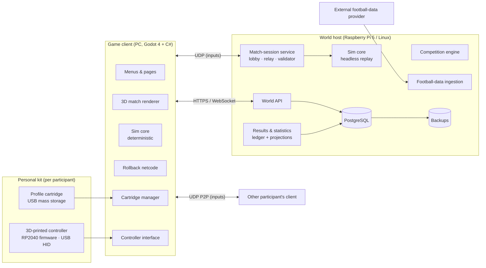

# Parallel Season FC — System Architecture

Status: proposal v0.1 · Companion to `01-requirements-review.md`

This document turns the product requirements into a buildable architecture: components, contracts, data model, key flows, technology choices with trade-offs, deployment, testing, and a phased build order. Assumptions A1–A7 from the requirements review apply throughout.

---

## 1. Architectural principles

1. **The world is a ledger.** Every accepted fact (result, event, transfer, correction, assignment) is an immutable, ordered event in the world's log. Standings, statistics, form, trophies and cartridge contents are projections rebuilt from that log. Nothing edits a projection directly.
2. **The simulation is a pure, deterministic library.** Same inputs and seed produce the same bytes everywhere. The rendering engine draws it; it never owns it. This single property gives us rollback netcode, desync detection, replays, and host-side result validation by replaying inputs.
3. **The host is the only authority on the record.** Clients produce input streams and evidence; the host produces accepted results. A cartridge is a signed cache of the host's view plus a revocable credential.
4. **External data is quarantined at the edge.** Provider payloads become normalised, provenance-stamped *proposals*. A separate step decides whether a proposal is allowed to become a world event. Imports can never touch a fixture that is `played`, `accepted` or `in_session`.
5. **Real and parallel are separate columns, never merged.** Every identifier, statistic and fixture carries which side of the takeover boundary it belongs to.
6. **Correctness over scale.** Twenty participants, a handful of concurrent matches. Prefer simple, replayable, auditable mechanisms to distributed ones.

---

## 2. System context



Two deployable programs plus firmware:

| Deployable | Runs on | Contains |
|------------|---------|----------|
| **Game client** | Participant PCs | Godot 4 app: UI, renderer, controller interface, cartridge manager, sim core, netcode, sync client |
| **World host** | Raspberry Pi 5 or any Linux server | ASP.NET Core service(s): world API, match-session service, competition engine, results/statistics, ingestion workers, headless sim verifier; PostgreSQL; backup jobs |
| **Controller firmware** | RP2040 in each controller | USB HID gamepad, calibration storage, debounce, optional rumble/battery |

The **sim core** is one C# library compiled into both the client and the host. It has no dependency on Godot.

---

## 3. Technology choices

| Concern | Choice | Alternatives considered | Why |
|---------|--------|-------------------------|-----|
| Game engine | **Godot 4.x (C#/.NET)** | Unity (licence volatility, closed), Unreal (heavy, C++ only sharing, far beyond need), custom engine (too much work) | Open source, exports to Windows/Linux/macOS, C# lets the sim core be shared with the .NET host verbatim, light enough for mid-range PCs, good gamepad support |
| Sim core language | **C# class library**, no engine types | C++ shared lib with P/Invoke | Same language on both sides; zero marshalling; easier testing |
| Determinism strategy | **Fixed-point arithmetic (Q32.32) + own trig/sqrt tables + fixed 60 Hz tick + seeded xoshiro PRNG**; no engine physics | IEEE float with strict compiler flags | .NET floats are mostly stable on x64 but `Math.*` differs across libm implementations and ARM vs x64; the host verifier runs on ARM. Fixed-point removes the question entirely |
| Host runtime | **ASP.NET Core (.NET 8 LTS)** minimal APIs + WebSockets; background workers | Node/TypeScript, Go, Python | Shares sim core and domain types with client; first-class on linux-arm64 |
| Database | **PostgreSQL 16** | SQLite (fine for single host, weaker concurrency/backup story), event store products (overkill) | Mature, runs on Pi, logical backups, JSONB for event payloads, advisory locks for session acceptance |
| Ledger style | **Event-sourced world log in Postgres** (`world_events` table) with projection tables | Pure CRUD with audit columns | Requirements §5, §7, §12, §16 are literally event-sourcing requirements |
| Netcode | **Deterministic lockstep with rollback (GGPO-style)**, P2P UDP with host relay fallback; inputs mirrored to host | Server-authoritative with client prediction | 2 players, small state, deterministic sim → rollback gives best feel and lets host validate by replay |
| Transport | UDP (inputs), WebSocket (lobby/session control), HTTPS (world API) | WebRTC data channels | Simpler; NAT traversal via host-assisted hole punching, relay fallback through the host |
| Cartridge medium | **USB mass storage** (flash PCB in Game Boy-style shell) | SD card read by controller MCU; smart card / secure element | Zero driver work, works on any PC, readable by a "borrowed" hub unit |
| Cartridge data format | Directory bundle: `manifest.json`, `profile.json`, `career.sqlite`, `settings.json`, `credential.bin`, `signature`; A/B generations | Single encrypted blob | Readable, repairable, partially upgradable; SQLite gives a queryable local career for offline browsing |
| Controller MCU | **RP2040** (TinyUSB composite HID) + USB 2.0 hub IC (e.g. Microchip USB2514B or FE1.1s) | ESP32-S3, STM32 | Cheap, excellent USB stack, the hub makes the cartridge slot an ordinary USB port |
| Deployment | Docker Compose on the Pi: `host-api`, `match-session`, `ingest`, `postgres`, `backup` | systemd units, Kubernetes | Reproducible, trivial to move to the "other servers" |
| Observability | OpenTelemetry → Prometheus + Grafana (optional), structured logs | — | Required by §16 performance measurements |

---

## 4. Components and contracts

Each component has an owner module in the repository, a published interface, and may only talk to others through that interface.

### 4.1 Client-side

**Controller interface** (`ParallelSeason.Client.Input`)
- Reads raw HID state via Godot `Input`; applies per-device calibration (dead zones, inversion, curves) and the participant's mapping to produce `GameAction` frames at 60 Hz.
- Binds a physical device (by USB serial) to a loaded participant; survives disconnect/reconnect; blocks a reconnecting device from taking the other team.
- Exposes the calibration/test page.

**Profile-cartridge manager** (`ParallelSeason.Client.Cartridge`)
- Watches removable volumes; recognises a cartridge by `manifest.json` schema and signature.
- States: `Detected → Validating → Loading → Synchronising → Ready → Saving → SafeToRemove`, plus `Rejected(reason)`.
- Performs the sync protocol (§6.6) and safe writes (write to inactive generation, fsync, flip `manifest.active`).
- Never executes anything from the cartridge. Validates every file against a schema and the host-signed revision.

**Game client shell** (Godot scenes)
- Pages from requirements §14. Pure presentation over the World API and the local cartridge SQLite.
- Match scene: drives `SimCore` at a fixed 60 Hz, renders interpolated state at display rate, broadcast camera, HUD, radar, replays from the recorded event/state stream.

**Sim core** (`ParallelSeason.Sim`) — shared
- Input: `MatchSetup` (two `TeamSnapshot`s, `RuleSet`, `Seed`, duration), then `Tick(InputFrame[2])`.
- Output: `MatchState` (positions, ball, clock, score, possession, phase), `MatchEvent`s (goal, assist, shot, save, foul, card, substitution, offside, kick-off, etc.), `StateHash` per tick.
- Contains: movement/dribbling, ball physics (3D flight, spin, bounce), passing/shooting models, tackling, goalkeeper model, team AI (roles, support, marking, transitions), referee/rules engine, CPU opponent controller with difficulty profiles.
- Deterministic by construction; unit tests assert replay equality on x64 and arm64.

**Netcode** (`ParallelSeason.Client.Net`)
- Rollback lockstep: predicts remote input, re-simulates up to N frames (N = 8 at 60 Hz ≈ 133 ms) when the real input arrives. Beyond N, stalls with "waiting for opponent".
- Sends every local `InputFrame` to the peer and to the match-session service (reliable, batched). Periodic `StateHash` exchange; divergence → pause, resync from host-held authoritative hash position, log desync.

### 4.2 Host-side

**World API** (`ParallelSeason.Host.Api`)
- Authentication: participant credential (from cartridge or login) → short-lived JWT scoped to `participant_id`, `world_id`, `device_id`. Devices are revocable (§12 recovery).
- Resources: worlds, memberships, club assignments, clubs, footballers, squads, fixtures, playing windows, appointments, results, standings, statistics, honours, settings versions, admin operations, cartridge revisions.
- All reads of projections; all writes become **commands** that are validated and appended as events.

**Match-session service** (`ParallelSeason.Host.Match`)
- Lobby: verifies both participants' tokens, club assignments, that the fixture is `open` and assigned source `played_vs_friend`/`played_vs_cpu`, that gameplay version + rule set + settings version match, and freezes the **fixture snapshot** (team snapshots, rules, seed) at `in_session`.
- Relay: UDP endpoint; forwards inputs when P2P fails; always records the authoritative **input log** (`session_id, tick, side, input`).
- Validator: on completion, replays the input log with the headless sim core from the frozen snapshot; the resulting `MatchEvent`s and final score are the only accepted outcome. Clients' reported scores are compared and logged but never trusted.
- Idempotent completion: `(fixture_id)` has at most one `accepted_result`; duplicate completion messages return the existing result.
- Session lifecycle: `created → ready_check → running → paused(reason, budget) → completed | abandoned(reason)`; reconnection window and pause budget from season settings; abandonment produces an `admin_resolution_required` event, never an automatic real-world substitution.

**Competition engine** (`ParallelSeason.Host.Competition`)
- Owns competition definitions (format, rules, tiebreakers, dates) per season.
- Builds the combined calendar for a club; maps **real fixtures** to **parallel fixtures** (1:1 while the worlds agree, 1:0 or 0:1 once they diverge).
- Assigns result sources in advance according to representation at window-open time (§6.3).
- Produces playing windows from season timezone and group rules.
- Progression: reads accepted results, decides who advances; reuses real later-round fixtures when both entrants and conditions still match, otherwise runs the **format-driven generator** (draw with seeded RNG, scheduling onto available match dates).
- Season completion and rollover (final tables, awards, qualification → next season entries).

**Results & statistics** (`ParallelSeason.Host.Ledger`)
- The append-only `world_events` log and its projections: results, standings, footballer statistics (split `inherited / earned / combined`), form, discipline, honours, head-to-head.
- Corrections: `result_corrected` event references the superseded event; projections are rebuilt from the log for the affected competition/season (not patched).

**Football-data ingestion** (`ParallelSeason.Host.Ingest`)
- Provider adapters implement `IFootballDataSource` (clubs, squads, fixtures, results, events, transfers). Each payload stored raw with `provider, endpoint, retrieved_at, coverage`.
- Normaliser maps provider IDs to internal IDs via `external_identity` table; unresolved → `identity_resolution_required` queue (admin page).
- Proposal gate: converts normalised data to **import proposals**; the gate applies the takeover and fixture-state rules and either appends `imported_*` events or parks the proposal with a reason. Never writes projections directly.

**Club & player catalogue / Squad & attribute system** (`ParallelSeason.Host.Catalogue`)
- Stable `club_id`, `footballer_id`; biographical and physical data; squad membership intervals with effective dates and source.
- Attribute model: `attribute_profile` versions per footballer with `basis` (`imported_model_v1`, `earned_adjustment`) so initial vs developed attributes stay separable.
- `TeamSnapshot` builder: for a fixture's reference instant, resolves eligible squad, attributes, numbers, suspensions, and freezes it.

**Community & administration** (`ParallelSeason.Host.Community`)
- Invitations, roles (`participant`, `commissioner`, `host_admin`), appointments between participants, notifications (in-app first; email/push optional), disputes, admin audit trail.

**Hosting & operations**
- Compose stack, nightly `pg_dump` + raw-payload archive to the second server, restore drill script, health endpoints, metrics.

---

## 5. Domain model

### 5.1 Core entities (relational, Postgres)

```
participant(id, display_name, created_at)
device(id, participant_id, kind{cartridge,login}, public_key, revoked_at)
world(id, name, season_timezone, created_at)
world_membership(world_id, participant_id, role, joined_at)
club(id, name, country, colours, stadium…)                       -- catalogue
club_assignment(id, world_id, club_id, participant_id, effective_from, effective_to, takeover_snapshot_id)
footballer(id, name, dob, foot, height…)                          -- catalogue
external_identity(provider, external_id, entity_type, internal_id, confidence, resolved_by)
squad_membership(id, club_id, footballer_id, from, to, shirt_no, source, provenance_id)
attribute_profile(id, footballer_id, version, basis, attributes jsonb, valid_from)
season(id, world_id, label, settings_version_id, status)
season_settings_version(id, season_id, version, settings jsonb, effective_from, authorised_by)
competition(id, season_id, kind, format jsonb, rules jsonb, tiebreakers jsonb)
competition_entry(competition_id, club_id, basis{real,parallel_qualification,generated})
real_fixture(id, provider_ref, competition_id, home_club_id, away_club_id, kickoff_utc, status, provenance_id)
fixture(id, competition_id, round, home_club_id, away_club_id, real_fixture_id NULL,
        match_day_local, window_open_utc, window_close_utc, deadline_kind{start,finish},
        result_source{played_vs_friend,played_vs_cpu,imported,generated,admin},
        state{scheduled,open,in_session,played,accepted,void,postponed,awaiting_admin})
fixture_snapshot(fixture_id, home_team_snapshot jsonb, away_team_snapshot jsonb, rules jsonb, seed, gameplay_version, taken_at)
appointment(id, fixture_id, proposed_by, proposed_at_utc, accepted_by, state)
match_session(id, fixture_id, kind{official,friendly}, state, started_at, ended_at, participants jsonb, gameplay_version)
match_input_log(session_id, tick, side, input bytes)               -- append-only, partitioned by session
accepted_result(fixture_id PK, session_id NULL, source, home_goals, away_goals, aet, pens, accepted_at, event_id)
match_event(id, fixture_id, source, minute, tick NULL, type, footballer_id, assist_footballer_id, team_club_id, payload jsonb)
world_event(seq BIGSERIAL, world_id, type, aggregate_type, aggregate_id, payload jsonb, caused_by, occurred_at, supersedes_seq NULL)
cartridge_revision(device_id, world_id, last_event_seq, manifest_hash, issued_at, signature)
import_payload(id, provider, endpoint, retrieved_at, coverage jsonb, raw jsonb)
import_proposal(id, payload_id, target_type, target_id, proposed jsonb, decision{applied,parked,rejected}, reason)
admin_action(id, actor_id, kind, target, reason, event_seq)
```

`accepted_result.fixture_id` being the primary key is the database-level guarantee of "one fixture, one result". `world_event.supersedes_seq` is how corrections reference what they replace.

### 5.2 World-event types (the ledger vocabulary)

| Category | Events |
|----------|--------|
| Membership | `participant_joined`, `club_assigned`, `club_assignment_ended`, `device_registered`, `device_revoked` |
| Takeover | `takeover_snapshot_recorded` (baseline: inherited history, standings position, squad, statistics as-of) |
| Catalogue | `imported_squad_membership_changed`, `imported_footballer_updated`, `attribute_profile_set` |
| Competition | `competition_defined`, `entries_set`, `fixture_created`, `fixture_linked_to_real`, `fixture_rescheduled`, `fixture_voided`, `draw_generated`, `window_assigned`, `result_source_assigned` |
| Match | `session_opened`, `snapshot_frozen`, `session_completed`, `session_abandoned`, `result_accepted`, `match_events_recorded` |
| Import | `imported_result_accepted`, `imported_match_events_recorded`, `import_parked` |
| Generation | `generated_result_accepted` (with model version + seed) |
| Admin | `result_corrected`, `fixture_admin_resolved`, `settings_version_published`, `identity_mapping_resolved` |
| Season | `season_completed`, `honours_awarded`, `qualification_determined`, `season_rolled_over` |

Projections rebuilt from these: `standings`, `footballer_season_stats(inherited, earned, combined)`, `club_form`, `discipline_ledger`, `honours`, `head_to_head`, `cartridge_career_view`.

### 5.3 Snapshot and statistic separation

A `TeamSnapshot` (frozen at `in_session`) contains for each footballer: `footballer_id`, shirt, position, `attribute_profile_id`, eligibility (`eligible | suspended | ineligible_transfer | injured(imported)`), and the squad-membership interval that justified inclusion. A later transfer import creates a new `squad_membership` row; it cannot modify a frozen snapshot, and the match's recorded lineup renders from the snapshot forever.

Footballer statistics are computed as:

- **inherited** = sum of imported match events for fixtures dated before the club's takeover (or for fixtures the world never replaced),
- **earned** = sum of match events whose fixture `result_source ∈ {played_vs_friend, played_vs_cpu}` (and `generated` for unrepresented sides when the group so configures),
- **combined** = inherited + earned.

Because the real version of a replaced fixture is never ingested as `imported_match_events_recorded` (the proposal gate rejects it: fixture is `played/accepted` with a non-import source), later real goals can never leak into totals.

---

## 6. Key flows

### 6.1 Takeover (profile creation and club selection)

1. Client → World API: `POST /worlds/{w}/assignments {club_id}`; host checks club has no active assignment (unless shared control enabled).
2. Ingestion fetches club identity, history, current season fixtures/results, squad, footballer profiles (jobs; progress visible on the Create/Join page with coverage status per information area).
3. **Proposal gate** applies each item: anything about a fixture the world already holds in `played/accepted` state is **parked** with reason `world_precedence`; everything else appends `imported_*` events.
4. `takeover_snapshot_recorded` captures the as-of baseline (inherited totals, position, honours) and the `effective_from` instant.
5. Competition engine builds the club's calendar; fixtures from `effective_from` onward get windows and result sources.
6. Cartridge revision issued; cartridge manager writes profile + career view.

### 6.2 Result-source assignment (in advance)

At `window_open_utc - lead_time` (season setting, e.g. 24 h) the engine appends `result_source_assigned`:

| Home represented | Away represented | Source |
|------------------|------------------|--------|
| yes | yes | `played_vs_friend` |
| yes | no  | `played_vs_cpu` (home participant plays) |
| no  | yes | `played_vs_cpu` (away participant plays) |
| no  | no  | `imported` if `real_fixture_id` present else `generated` |

A participant's temporary unavailability does not change the source; a missed window becomes `awaiting_admin`, never a silent fallback.

### 6.3 Official match (online)

```mermaid
sequenceDiagram
    participant A as Client A
    participant H as Match-session service
    participant B as Client B
    A->>H: join(fixture, token, gameplay_version, settings_version)
    B->>H: join(...)
    H->>H: verify assignments, window open, source=played_vs_friend
    H->>H: freeze fixture_snapshot (teams, rules, seed)
    H-->>A: lobby state (identities, kits, snapshots, rules)
    H-->>B: lobby state
    A->>H: ready ; B->>H: ready
    H-->>A: start(tick 0, peer endpoint)
    H-->>B: start(tick 0, peer endpoint)
    loop every tick
        A-->>B: input frame (P2P UDP)
        B-->>A: input frame (P2P UDP)
        A-->>H: input frames (batched, reliable)
        B-->>H: input frames (batched, reliable)
        A-->>H: state hash every 60 ticks
        B-->>H: state hash every 60 ticks
    end
    A->>H: completed(final hash, claimed score)
    B->>H: completed(final hash, claimed score)
    H->>H: replay input log headlessly from snapshot
    H->>H: compare hashes; append result_accepted + match_events_recorded (idempotent on fixture_id)
    H-->>A: accepted result + new cartridge revision
    H-->>B: accepted result + new cartridge revision
```

Same-room play is identical except one client hosts both controllers and sends both input sides; the host still replays and accepts. A friendly uses `match_session.kind = friendly` and can never target an official fixture's `accepted_result`.

Pause budget, reconnection window and abandonment behaviour come from the frozen settings version. On abandonment the fixture goes `awaiting_admin` with the input log preserved so a commissioner can inspect and resolve (replay from log, award, void, or reschedule).

### 6.4 CPU match

Single client; the CPU side's inputs are produced by the sim core's CPU controller **inside the deterministic simulation** from the seed, so the host's replay reproduces the CPU's decisions too. Only the human side's inputs are logged.

### 6.5 Background import of an unrepresented fixture

1. Ingest job fetches results and events for `real_fixture`s whose linked `fixture.result_source = imported` and `state = open` and whose real match is finished.
2. Normalise identities; unresolved footballers → admin queue, fixture still accepted at score level with events marked `incomplete`.
3. Proposal gate → `imported_result_accepted`, `imported_match_events_recorded(coverage)`.
4. Projections update; the fixture becomes `accepted`.

### 6.6 Cartridge synchronisation

Cartridge `manifest.json` carries `world_id`, `participant_id`, `device_id`, `revision.last_event_seq`, `revision.signature` (host-signed). On insertion:

1. Validate schema and signature; refuse unsigned or mismatched worlds; refuse a `device_id` that the host reports revoked.
2. Ask host: `GET /sync?since={last_event_seq}`; receive the event delta and new signed revision. The cartridge is **never** a source of world events, so an older cartridge cannot reverse anything; it simply fast-forwards.
3. Pending local-only data (settings, lineups, tactics) is pushed as commands; conflicts resolve last-writer-wins on *personal* data only.
4. Rebuild `career.sqlite` view locally; write to inactive generation; fsync; flip `manifest.active`.
5. If the host is unreachable: load the cached view read-only for browsing/practice; official fixtures are unavailable (A3).

Duplicate cartridges: the host's refresh-token rotation detects two devices presenting the same `device_id` family and marks the second as `suspect`; a commissioner resolves. Replacement: new `device_id` registered to the participant, old revoked, full career view written from the ledger.

### 6.7 Cup divergence and generation

1. After `result_accepted` for a knockout tie, progression computes the winner from the parallel record (aggregate, away goals if the competition's rules say so, extra time, penalties).
2. Engine looks for the real next-round fixture: if its two entrants equal the parallel entrants, it links (`fixture_linked_to_real`), otherwise it appends `draw_generated` for the affected ties using the competition's draw rules and seeded RNG, schedules onto the competition's declared match dates, and assigns sources.
3. Unrepresented-vs-unrepresented generated fixtures resolve at window close via the **generated-result model** (`model_version`, `seed`, team strength from attribute profiles → expected goals → Poisson → scorer sampling weighted by position/finishing). Recorded as `generated_result_accepted` and shown with the label "generated".

### 6.8 Correction

Commissioner → `POST /admin/results/{fixture}/correct {new outcome, reason}` → `result_corrected(supersedes_seq)`. Projection rebuild for the fixture's competition and season runs from the log, treating superseded events as inert. Original stays visible in history with its reason.

---

## 7. Interfaces (summary)

### 7.1 World API (HTTPS, JSON)

```
POST /auth/device                      cartridge credential → JWT
GET  /worlds/{w}                        world summary, settings version
GET  /worlds/{w}/clubs                  availability, ownership
POST /worlds/{w}/assignments            take over a club
GET  /worlds/{w}/me/dashboard           today's fixture, upcoming, recent, squad changes, friends' activity
GET  /worlds/{w}/fixtures?club=&from=&to=
GET  /worlds/{w}/fixtures/{f}           window, source, snapshot status, appointment
POST /worlds/{w}/fixtures/{f}/appointments   propose/accept
GET  /worlds/{w}/competitions/{c}/table  parallel table (+ real for comparison, separately keyed)
GET  /worlds/{w}/footballers/{p}         inherited / earned / combined, attributes, form
GET  /worlds/{w}/career                  honours, rivalries, archives
PUT  /worlds/{w}/me/team-setup           lineups, formation, tactics
GET  /sync?since=                        event delta + signed revision
POST /admin/...                          corrections, rescheduling, identity resolution, ownership
```

### 7.2 Match-session protocol (WebSocket control + UDP data)

Control: `Join`, `LobbyState`, `Ready`, `Start`, `Pause`, `Resume`, `Reconnect`, `Complete`, `Abandon`, `Accepted`. Data: `InputBatch{session, side, first_tick, inputs[]}`, `StateHash{tick, hash}`, `Ping`. Input frames are 8 bytes (two sticks × 2 axes as int8, 16 button bits, 2 reserved); a match played as two 6-minute halves runs about 43 k ticks at 60 Hz, roughly 350 KB of input per side, trivially storable.

### 7.3 Sim core API

```csharp
var sim = new MatchSimulation(setup);          // MatchSetup: snapshots, RuleSet, seed, duration
sim.Tick(new InputFrame[] { home, away });     // 60 Hz
MatchState s = sim.State;                      // for rendering/interpolation
IReadOnlyList<MatchEvent> ev = sim.DrainEvents();
ulong h = sim.StateHash();
byte[] save = sim.Serialize(); sim.Restore(save); // rollback
```

### 7.4 Football-data adapter

```csharp
interface IFootballDataSource {
  Task<Payload<ClubDto>>        GetClub(string extId);
  Task<Payload<SquadDto>>       GetSquad(string extClubId, DateOnly asOf);
  Task<Payload<FixtureDto[]>>   GetFixtures(string extCompetitionId, string season);
  Task<Payload<ResultDto>>      GetResult(string extFixtureId);
  Task<Payload<MatchEventDto[]>> GetEvents(string extFixtureId);     // coverage flagged
  Task<Payload<TransferDto[]>>  GetTransfers(string extClubId, DateOnly since);
}
record Payload<T>(T Data, string Provider, string Endpoint, DateTimeOffset RetrievedAt, Coverage Coverage);
```

---

## 8. Hardware architecture

```
┌──────────────────────────── Controller enclosure ────────────────────────────┐
│  [RP2040]──HID──┐                                                           │
│  sticks×2  ──── │        ┌──────────┐                                       │
│  buttons   ──── ├────────┤ USB 2.0  ├──── USB-C to PC                       │
│  triggers  ──── │        │   hub    │                                       │
│  rumble/batt ───┘        └────┬─────┘                                       │
│                               │ downstream port                             │
│                     ┌─────────┴─────────┐                                   │
│                     │  cartridge slot   │ ← spring contacts / USB-C recept. │
│                     └───────────────────┘                                   │
└──────────────────────────────────────────────────────────────────────────────┘
          Cartridge: USB flash PCB in Game Boy-style shell, keyed so it only
          inserts one way; the same shell also clips to the controller back
          for transport (the clip is mechanical only).
```

- The PC sees two independent devices: a gamepad (serial = controller ID) and a removable disk (volume label = `PSFC-<cartridge id>`). Gameplay input never waits on disk I/O.
- A standalone **profile-loading unit** is the same hub + slot without the MCU, satisfying "borrowed or replacement controller".
- Firmware: TinyUSB HID gamepad descriptor (2 × 2 axes 16-bit, 1 hat, 16 buttons), 1 kHz poll, debounce in firmware, calibration stored in RP2040 flash and mirrored to the cartridge `settings.json` (cartridge copy wins when both present, so a borrowed controller still feels right). UF2 drag-and-drop updates with the second flash slot kept as a fallback image.

---

## 9. Deployment and operations

```
Raspberry Pi 5 (8 GB, NVMe) — "world host"
  docker compose:
    postgres:16          (volume on NVMe)
    host-api             (ASP.NET Core; World API + Community)
    match-session        (lobby WS, UDP relay :7777, validator worker)
    ingest               (provider adapters, proposal gate, schedulers)
    backup               (nightly pg_dump + payload archive → other server via rsync/restic)
    caddy                (TLS termination, reverse proxy)
Other server(s): backup target, optional second relay region, Grafana.
Clients: Windows/Linux PCs running the Godot build; auto-update via signed release manifest.
```

Performance targets to measure (§16):

| Metric | Target |
|--------|--------|
| Sim tick cost (client, 22 players) | < 2 ms |
| Client render | 60 fps at 1080p on a GTX 1060-class GPU |
| Local input-to-photon latency | < 50 ms |
| Online rollback budget | 8 frames (≈133 ms RTT) before stall |
| Host replay of a full match (Pi 5, arm64) | < 30 s |
| World API p95 | < 200 ms |
| Concurrent official sessions on the Pi | 4 |
| Backup restore drill | < 30 min, run quarterly |

Security: TLS everywhere; JWT with device binding; cartridge credential is a refresh token scoped to one participant and one world, revocable; no admin credentials on cartridges; all cartridge files schema-validated; input logs and events are the only accepted evidence of a result.

---

## 10. Testing strategy

| Layer | Approach |
|-------|----------|
| Sim determinism | Golden replays: record input logs, assert identical `StateHash` sequence on x64 Windows, x64 Linux, arm64 Linux in CI. Fuzzed inputs for thousands of matches. |
| Rules engine | Scenario tests (offside, advantage, second yellow, aggregate/away goals, shootout order). |
| Ledger invariants | Property tests: random event sequences + corrections → rebuilt projections equal incremental ones; no fixture ever has two results; replaced fixtures never receive imported events. |
| Proposal gate | Table-driven tests for every fixture state × import type. |
| Competition engine | Format conformance tests per competition; divergence scenarios (cup upset, parallel qualification). |
| Netcode | Simulated latency/loss harness; desync injection; reconnection. |
| Cartridge | Power-cut simulation during write (kill mid-write, assert previous generation loads); corrupt-file rejection. |
| Hardware | Bench rig: scripted button/stick sequences, HID report timing, hub enumeration with cartridge hot-plug during gameplay. |
| End-to-end | The §19 acceptance table encoded as automated scenarios against a Compose test stack. |

---

## 11. Repository layout (proposed)

```
/client/            Godot 4 project (C#)
/sim/               ParallelSeason.Sim (deterministic core) + tests
/shared/            Domain contracts, DTOs, event schemas, fixed-point math
/host/              ASP.NET Core services: Api, Match, Competition, Ledger, Ingest, Community
/firmware/          RP2040 (Pico SDK + TinyUSB) controller firmware
/hardware/          KiCad PCBs, 3D-printable enclosures, BOM
/cartridge/         Save-format spec and validators
/deploy/            docker-compose, Caddy, backup scripts, Grafana dashboards
/docs/              This document, ADRs, season rules
```

---

## 12. Phased build order

| Phase | Goal | Exit criterion |
|-------|------|----------------|
| 0 Foundations | Repo re-init (Godot + .NET), fixed-point math, sim skeleton with hash + replay harness, ledger schema and event store, proposal gate | A recorded input log replays identically on x64 and arm64; property tests green |
| 1 Playable core | Movement, pass, shoot, tackle, switching, GK AI, basic rules, two local controllers, capsule visuals | Two people finish a 2×4-minute match locally; events recorded |
| 2 World & season | Takeover import, calendar, windows, result-source assignment, CPU matches, standings/stats projections, dashboard pages | A one-participant season runs end to end with imported background results |
| 3 Personal kit | Controller firmware + hub PCB, cartridge format, cartridge manager, sync protocol, enclosures | Cartridge inserted on another PC restores identity and career; power-cut test passes |
| 4 Online play | Lobby, rollback netcode, relay, validator, idempotent acceptance | Two homes play an official fixture; host-replayed result accepted once |
| 5 Divergence & rollover | Full competition formats, generator, generated-result model, season completion, qualification | Parallel cup winner ≠ real; next season's European entries follow the parallel record |
| 6 Feel & presentation | Skill moves, animation, stadiums, kits, broadcast camera, replays, audio | Group signs off on "feels like 2010 FIFA" against the §9 checklist |

Phases 2–3 can proceed in parallel with phase 1 since they do not depend on gameplay feel.

---

## 13. Decisions to confirm with the group

1. Godot 4 + C# as the engine (vs Unity/Unreal).
2. Fixed-point deterministic sim (accepting more up-front maths work for guaranteed cross-platform replay).
3. Cartridge = USB mass storage behind a hub in the controller (vs MCU-read SD card).
4. Official matches require host connectivity in v1 (no offline official results).
5. Match duration and difficulty as frozen season settings; which assistance settings are allowed in official fixtures.
6. Which football-data provider, and whether event-level coverage for unrepresented matches is purchased.
7. Generated-result model acceptance (rating-based Poisson) and whether its goals count toward footballer "earned" statistics for unrepresented clubs.
8. Who holds the `commissioner` role and the dispute process.

## 14. What to revisit as the system grows

- If several friend groups want separate worlds on one host: the schema already keys everything by `world_id`; add per-world rate limits and storage quotas.
- If matches move beyond 2 participants (shared control, spectators): the input log and rollback are per-side today; extending to N inputs is mechanical, but lobby and controller assignment UI need redesign.
- If the Pi becomes a bottleneck for replay validation: move the validator worker to the other server; it is already a separate process consuming from the input-log table.
- If a provider is replaced: only `/host/Ingest/Adapters/<Provider>` changes; identities survive via `external_identity`.
