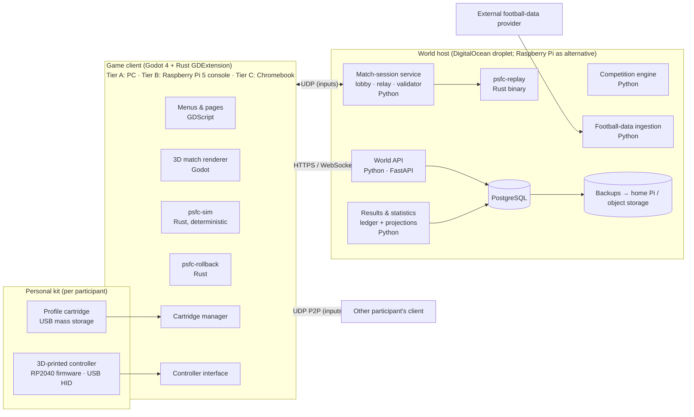

# Parallel Season FC — System Architecture

Status: proposal v0.2 · Companion to `01-requirements-review.md` · Decisions recorded in `docs/adr/`

This document turns the product requirements into a buildable architecture: components, contracts, data model, key flows, technology choices with trade-offs, deployment, testing, and a phased build order. Assumptions A1–A7 from the requirements review apply throughout.

**Changes from v0.1.** The simulation core moves from C# to Rust and the host services from ASP.NET Core to Python. The only reason v0.1 coupled the host language to the client language was so the host could replay matches with the same simulation code; packaging the replay verifier as a standalone Rust binary removes that coupling and lets each side use the language that suits it. The DigitalOcean droplet becomes the primary world host because a public address simplifies online play. Raspberry Pi 5 is promoted from "host only" to a constrained living-room console client, subject to a measured render budget in phase 1. Chromebooks are a best-effort client tier. See ADR-0001 and ADR-0002.

---

## 1. Architectural principles

1. **The world is a ledger.** Every accepted fact (result, event, transfer, correction, assignment) is an immutable, ordered event in the world's log. Standings, statistics, form, trophies and cartridge contents are projections rebuilt from that log. Nothing edits a projection directly.
2. **The simulation is a pure, deterministic library.** Same inputs and seed produce the same bytes everywhere. The rendering engine draws it; it never owns it. This single property gives us rollback netcode, desync detection, replays, and host-side result validation by replaying inputs.
3. **The host is the only authority on the record.** Clients produce input streams and evidence; the host produces accepted results. A cartridge is a signed cache of the host's view plus a revocable credential.
4. **External data is quarantined at the edge.** Provider payloads become normalised, provenance-stamped *proposals*. A separate step decides whether a proposal is allowed to become a world event. Imports can never touch a fixture that is `played`, `accepted` or `in_session`.
5. **Real and parallel are separate columns, never merged.** Every identifier, statistic and fixture carries which side of the takeover boundary it belongs to.
6. **Each language stays in its lane.** Rust for anything that must be deterministic or real-time (simulation, rollback, replay verification). Python for records, rules, data wrangling and administration. GDScript only as presentation glue inside Godot. No business logic in the engine.
7. **Correctness over scale.** Twenty participants, a handful of concurrent matches. Prefer simple, replayable, auditable mechanisms to distributed ones.

---

## 2. System context



Three deployables plus firmware:

| Deployable | Runs on | Contains |
|------------|---------|----------|
| **Game client** | Participant PCs (tier A); Raspberry Pi 5 in a printed console shell (tier B); Chromebooks via the Linux container (tier C, best effort) | Godot 4 project: UI, renderer, controller interface, cartridge manager, sync client; Rust GDExtension carrying the simulation and rollback netcode |
| **World host** | DigitalOcean droplet (primary) or a Raspberry Pi 5 at home | Python services: world API, match-session service, competition engine, results/statistics, ingestion workers, community/admin; PostgreSQL; the Rust `psfc-replay` verifier binary; backup jobs |
| **Rust workspace** | Compiled into both of the above | `psfc-sim` (deterministic core), `psfc-rollback` (prediction and re-simulation), `psfc-godot` (GDExtension bindings), `psfc-replay` (headless CLI used by the host and by CI) |
| **Controller firmware** | RP2040 in each controller | USB HID gamepad, calibration storage, debounce, optional rumble/battery |

The simulation has no dependency on Godot, Python, or any network library. It is a Rust crate with a `tick` function.

---

## 3. Technology choices

| Concern | Choice | Alternatives considered | Why |
|---------|--------|-------------------------|-----|
| Game engine | **Godot 4.3+**, GDScript for presentation glue only, simulation via GDExtension | Unity (licence volatility, closed), Unreal (heavy, far beyond need), browser client with Three.js and a WASM sim (see ADR-0002), custom engine | Open source; official Windows, Linux x86-64, Linux arm64 and macOS builds; the Compatibility renderer runs on Raspberry Pi 5; the editor is the productivity win for scenes, animation state machines and UI |
| Simulation language | **Rust** (`psfc-sim`), `#![forbid(unsafe_code)]`, no floating point in simulation state (clippy `float_arithmetic` denied) | C# (v0.1; ties host to .NET and blocks Godot web export), C++ GDExtension (same performance, weaker safety), GDScript (too slow for 60 Hz rollback re-simulation, no numeric control) | Compiles identically to x86-64, aarch64 and wasm32; no garbage collector pauses; explicit integer semantics for determinism; one crate serves client, host and CI |
| Determinism strategy | **Fixed-point arithmetic (i64, Q32.32) + table-based trig and sqrt + fixed 60 Hz tick + seeded xoshiro256** PRNG; single-threaded sim; no engine physics | IEEE float with strict flags | Removes every cross-platform numeric question; WASM and ARM replays match x86 bit for bit |
| Host runtime | **Python 3.12, FastAPI, SQLAlchemy 2 (async) + asyncpg, Pydantic v2, Alembic, httpx**; asyncio `DatagramProtocol` for the UDP relay | Go (single static binary, better raw concurrency; see ADR-0001), Rust (one language everywhere, slow iteration on CRUD and rules code), ASP.NET Core (v0.1), TypeScript | The host is records, rules, provider data wrangling and admin tooling, which is Python's strongest territory; online load at this scale is trivial for any of these runtimes; the only compute-heavy host job, replay verification, is delegated to the Rust binary |
| Replay verification | **`psfc-replay` CLI** invoked by the match-session worker as a subprocess | PyO3 extension module (in-process), separate verifier microservice | Zero FFI, crash isolation, identical binary used in CI determinism tests |
| Database | **PostgreSQL 16** | SQLite (fine on one box, weaker backup and concurrency story), event-store products (overkill) | Mature, runs on a small droplet and on a Pi, logical backups, JSONB payloads, advisory locks for acceptance |
| Ledger style | **Event-sourced world log in Postgres** (`world_event` table) with projection tables | CRUD with audit columns | Requirements §5, §7, §12 and §16 are event-sourcing requirements stated in plain language |
| Netcode | **Deterministic lockstep with rollback (GGPO-style)** in `psfc-rollback`; transport behind a trait; P2P UDP first, relay through the host as fallback; inputs mirrored to the host | Server-authoritative with client prediction | Two players and a small state make rollback the best-feeling option, and it lets the host validate by replay |
| Transport | UDP for inputs, WebSocket for lobby and session control, HTTPS for the world API | WebRTC data channels (needed only if a browser client is built) | Simple; host-assisted hole punching with relay fallback on the public droplet |
| Cartridge medium | **USB mass storage** (flash PCB in a Game Boy-style shell) | SD card read by the controller MCU; secure element | Zero driver work on every client tier including ChromeOS; readable by a "borrowed" hub unit |
| Cartridge data format | Directory bundle: `manifest.json`, `profile.json`, `career.sqlite`, `settings.json`, `credential.bin`, `signature`; A/B generations | Single encrypted blob | Readable, repairable, partially upgradable; SQLite gives a queryable local career for offline browsing |
| Controller MCU | **RP2040** (TinyUSB composite HID) + USB 2.0 hub IC (Microchip USB2514B or FE1.1s) | ESP32-S3, STM32 | Cheap, excellent USB stack; the hub makes the cartridge slot an ordinary USB port |
| Deployment | Docker Compose on the droplet: `postgres`, `api`, `match`, `ingest`, `caddy`, `backup`; same Compose file runs on a Pi | systemd units, Kubernetes | Reproducible; host location is a one-line change |
| Observability | OpenTelemetry → Prometheus + Grafana (optional), structured JSON logs | — | Required by §16 performance measurements |

---

## 4. Components and contracts

Each component has an owner module in the repository, a published interface, and may only talk to others through that interface.

### 4.1 Client-side

**Controller interface** (`client/scripts/input/`, GDScript over Godot `Input`)
- Reads raw HID state; applies per-device calibration (dead zones, inversion, curves) and the participant's mapping to produce `InputFrame`s at 60 Hz for the simulation.
- Binds a physical device (by USB serial) to a loaded participant; survives disconnect and reconnect; blocks a reconnecting device from taking the other team.
- Exposes the calibration and test page.

**Profile-cartridge manager** (`client/scripts/cartridge/`)
- Watches removable volumes; recognises a cartridge by `manifest.json` schema and signature.
- States: `Detected → Validating → Loading → Synchronising → Ready → Saving → SafeToRemove`, plus `Rejected(reason)`.
- Performs the sync protocol (§6.6) and safe writes (write to inactive generation, fsync, flip `manifest.active`).
- Never executes anything from the cartridge. Validates every file against a schema and the host-signed revision.

**Game client shell** (Godot scenes, GDScript)
- Pages from requirements §14. Pure presentation over the World API and the local cartridge SQLite.
- Match scene: calls `psfc-godot` at a fixed 60 Hz, renders interpolated state at display rate, broadcast camera, HUD, radar, replays from the recorded event and state stream.
- Three render tiers selected at startup (§9.2).

**Simulation core** (`sim/psfc-sim`, Rust) — shared with the host
- Input: `MatchSetup` (two `TeamSnapshot`s, `RuleSet`, `seed`, duration), then `tick(&[InputFrame; 2])`.
- Output: `MatchState` (positions, ball, clock, score, possession, phase), `MatchEvent`s (goal, assist, shot, save, foul, card, substitution, offside, kick-off and so on), `state_hash()` per tick, `save_state()` and `load_state()` for rollback.
- Contains: movement and dribbling, ball physics (3D flight, spin, bounce), passing and shooting models, tackling, goalkeeper model, team AI (roles, support, marking, transitions), referee and rules engine, CPU opponent controller with difficulty profiles.
- Deterministic by construction; CI asserts replay equality on x86-64, aarch64 and wasm32.

**Rollback netcode** (`sim/psfc-rollback`, Rust)
- Predicts remote input, re-simulates up to 8 frames (about 133 ms at 60 Hz) when the real input arrives. Beyond that, stalls with "waiting for opponent".
- Sends every local `InputFrame` to the peer and to the match-session service (reliable, batched). Periodic `state_hash` exchange; divergence pauses the match, resynchronises from the host-held authoritative hash position, and logs the desync.
- Transport is a trait. Native builds use a UDP socket owned by the extension; a WebRTC implementation would be added for a browser build.

**GDExtension bindings** (`sim/psfc-godot`, Rust via `gdext`)
- Exposes `MatchSimulation` and `RollbackSession` classes to Godot. State crosses the boundary as packed arrays (positions, orientations, animation cues), events as dictionaries. Pinned to the Godot minor version in use.

### 4.2 Host-side (Python unless stated)

**World API** (`host/psfc_host/api/`)
- Authentication: participant credential (from cartridge or login) → short-lived JWT scoped to `participant_id`, `world_id`, `device_id`. Devices are revocable (§12 recovery).
- Resources: worlds, memberships, club assignments, clubs, footballers, squads, fixtures, playing windows, appointments, results, standings, statistics, honours, settings versions, admin operations, cartridge revisions.
- Reads serve projections; writes become **commands** that are validated and appended as events.

**Match-session service** (`host/psfc_host/match/`)
- Lobby: verifies both participants' tokens, club assignments, that the fixture is `open` and assigned source `played_vs_friend` or `played_vs_cpu`, that gameplay version, rule set and settings version match, and freezes the **fixture snapshot** (team snapshots, rules, seed) at `in_session`.
- Relay: asyncio UDP endpoint; forwards inputs when P2P fails; always records the authoritative **input log** (`session_id, tick, side, input`).
- Validator: on completion, runs `psfc-replay --snapshot … --inputs …` and accepts only the score and `MatchEvent`s the replay produces. Clients' reported scores are compared and logged but never trusted.
- Idempotent completion: `fixture_id` has at most one `accepted_result`; duplicate completion messages return the existing result.
- Session lifecycle: `created → ready_check → running → paused(reason, budget) → completed | abandoned(reason)`; reconnection window and pause budget from season settings; abandonment produces an `admin_resolution_required` event, never an automatic real-world substitution.

**Competition engine** (`host/psfc_host/competition/`)
- Owns competition definitions (format, rules, tiebreakers, dates) per season.
- Builds the combined calendar for a club; maps **real fixtures** to **parallel fixtures** (1:1 while the worlds agree, 1:0 or 0:1 once they diverge).
- Assigns result sources in advance according to representation at window-open time (§6.2).
- Produces playing windows from season timezone and group rules.
- Progression: reads accepted results, decides who advances; reuses real later-round fixtures when both entrants and conditions still match, otherwise runs the **format-driven generator** (seeded draw, scheduling onto declared match dates).
- Season completion and rollover (final tables, awards, qualification → next season entries).

**Results & statistics** (`host/psfc_host/ledger/`)
- The append-only `world_event` log and its projections: results, standings, footballer statistics split into inherited, earned and combined, form, discipline, honours, head-to-head.
- Corrections: a `result_corrected` event references the superseded event; projections for the affected competition and season are rebuilt from the log, not patched.

**Football-data ingestion** (`host/psfc_host/ingest/`)
- Provider adapters implement the `FootballDataSource` protocol (clubs, squads, fixtures, results, events, transfers). Each payload is stored raw with `provider, endpoint, retrieved_at, coverage`.
- Normaliser maps provider IDs to internal IDs via `external_identity`; unresolved → `identity_resolution_required` queue (admin page).
- Proposal gate: converts normalised data to **import proposals**; the gate applies the takeover and fixture-state rules and either appends `imported_*` events or parks the proposal with a reason. Never writes projections directly.

**Club & player catalogue / squad & attribute system** (`host/psfc_host/catalogue/`)
- Stable `club_id`, `footballer_id`; biographical and physical data; squad membership intervals with effective dates and source.
- Attribute model: `attribute_profile` versions per footballer with `basis` (`imported_model_v1`, `earned_adjustment`) so initial and developed attributes stay separable.
- `TeamSnapshot` builder: for a fixture's reference instant, resolves eligible squad, attributes, numbers, suspensions, and freezes it.

**Community & administration** (`host/psfc_host/community/`)
- Invitations, roles (`participant`, `commissioner`, `host_admin`), appointments between participants, notifications (in-app first; email or push optional), disputes, admin audit trail.

**Hosting & operations**
- Compose stack, nightly `pg_dump` plus raw-payload archive to the home Pi or object storage, restore drill script, health endpoints, metrics.

---

## 5. Domain model

### 5.1 Core entities (relational, Postgres)

```
participant(id, display_name, created_at)
device(id, participant_id, kind{cartridge,login}, public_key, revoked_at)
world(id, name, season_timezone, created_at)
world_membership(world_id, participant_id, role, joined_at)
club(id, name, country, colours, stadium…)                       -- catalogue
club_assignment(id, world_id, club_id, participant_id, effective_from, effective_to, takeover_snapshot_id)
footballer(id, name, dob, foot, height…)                          -- catalogue
external_identity(provider, external_id, entity_type, internal_id, confidence, resolved_by)
squad_membership(id, club_id, footballer_id, from, to, shirt_no, source, provenance_id)
attribute_profile(id, footballer_id, version, basis, attributes jsonb, valid_from)
season(id, world_id, label, settings_version_id, status)
season_settings_version(id, season_id, version, settings jsonb, effective_from, authorised_by)
competition(id, season_id, kind, format jsonb, rules jsonb, tiebreakers jsonb)
competition_entry(competition_id, club_id, basis{real,parallel_qualification,generated})
real_fixture(id, provider_ref, competition_id, home_club_id, away_club_id, kickoff_utc, status, provenance_id)
fixture(id, competition_id, round, home_club_id, away_club_id, real_fixture_id NULL,
        match_day_local, window_open_utc, window_close_utc, deadline_kind{start,finish},
        result_source{played_vs_friend,played_vs_cpu,imported,generated,admin},
        state{scheduled,open,in_session,played,accepted,void,postponed,awaiting_admin})
fixture_snapshot(fixture_id, home_team_snapshot jsonb, away_team_snapshot jsonb, rules jsonb, seed, gameplay_version, taken_at)
appointment(id, fixture_id, proposed_by, proposed_at_utc, accepted_by, state)
match_session(id, fixture_id, kind{official,friendly}, state, started_at, ended_at, participants jsonb, gameplay_version)
match_input_log(session_id, tick, side, input bytes)               -- append-only, partitioned by session
accepted_result(fixture_id PK, session_id NULL, source, home_goals, away_goals, aet, pens, accepted_at, event_id)
match_event(id, fixture_id, source, minute, tick NULL, type, footballer_id, assist_footballer_id, team_club_id, payload jsonb)
world_event(seq BIGSERIAL, world_id, type, aggregate_type, aggregate_id, payload jsonb, caused_by, occurred_at, supersedes_seq NULL)
cartridge_revision(device_id, world_id, last_event_seq, manifest_hash, issued_at, signature)
import_payload(id, provider, endpoint, retrieved_at, coverage jsonb, raw jsonb)
import_proposal(id, payload_id, target_type, target_id, proposed jsonb, decision{applied,parked,rejected}, reason)
admin_action(id, actor_id, kind, target, reason, event_seq)
```

`accepted_result.fixture_id` being the primary key is the database-level guarantee of "one fixture, one result". `world_event.supersedes_seq` is how corrections reference what they replace.

### 5.2 World-event types (the ledger vocabulary)

| Category | Events |
|----------|--------|
| Membership | `participant_joined`, `club_assigned`, `club_assignment_ended`, `device_registered`, `device_revoked` |
| Takeover | `takeover_snapshot_recorded` (baseline: inherited history, standings position, squad, statistics as-of) |
| Catalogue | `imported_squad_membership_changed`, `imported_footballer_updated`, `attribute_profile_set` |
| Competition | `competition_defined`, `entries_set`, `fixture_created`, `fixture_linked_to_real`, `fixture_rescheduled`, `fixture_voided`, `draw_generated`, `window_assigned`, `result_source_assigned` |
| Match | `session_opened`, `snapshot_frozen`, `session_completed`, `session_abandoned`, `result_accepted`, `match_events_recorded` |
| Import | `imported_result_accepted`, `imported_match_events_recorded`, `import_parked` |
| Generation | `generated_result_accepted` (with model version and seed) |
| Admin | `result_corrected`, `fixture_admin_resolved`, `settings_version_published`, `identity_mapping_resolved` |
| Season | `season_completed`, `honours_awarded`, `qualification_determined`, `season_rolled_over` |

Projections rebuilt from these: `standings`, `footballer_season_stats(inherited, earned, combined)`, `club_form`, `discipline_ledger`, `honours`, `head_to_head`, `cartridge_career_view`.

### 5.3 Snapshot and statistic separation

A `TeamSnapshot` (frozen at `in_session`) contains for each footballer: `footballer_id`, shirt, position, `attribute_profile_id`, eligibility (`eligible | suspended | ineligible_transfer | injured(imported)`), and the squad-membership interval that justified inclusion. A later transfer import creates a new `squad_membership` row; it cannot modify a frozen snapshot, and the match's recorded lineup renders from the snapshot forever.

Footballer statistics are computed as:

- **inherited** = sum of imported match events for fixtures dated before the club's takeover, or for fixtures the world never replaced,
- **earned** = sum of match events whose fixture `result_source ∈ {played_vs_friend, played_vs_cpu}` (and `generated` for unrepresented sides when the group so configures),
- **combined** = inherited + earned.

Because the real version of a replaced fixture is never ingested as `imported_match_events_recorded` (the proposal gate rejects it: fixture is `played` or `accepted` with a non-import source), later real goals can never leak into totals.

---

## 6. Key flows

### 6.1 Takeover (profile creation and club selection)

1. Client → World API: `POST /worlds/{w}/assignments {club_id}`; host checks the club has no active assignment (unless shared control is enabled).
2. Ingestion fetches club identity, history, current-season fixtures and results, squad, footballer profiles (background jobs; progress visible on the Create/Join page with coverage status per information area).
3. **Proposal gate** applies each item: anything about a fixture the world already holds in `played` or `accepted` state is **parked** with reason `world_precedence`; everything else appends `imported_*` events.
4. `takeover_snapshot_recorded` captures the as-of baseline (inherited totals, position, honours) and the `effective_from` instant.
5. Competition engine builds the club's calendar; fixtures from `effective_from` onward get windows and result sources.
6. Cartridge revision issued; cartridge manager writes profile and career view.

### 6.2 Result-source assignment (in advance)

At `window_open_utc - lead_time` (season setting, for example 24 h) the engine appends `result_source_assigned`:

| Home represented | Away represented | Source |
|------------------|------------------|--------|
| yes | yes | `played_vs_friend` |
| yes | no  | `played_vs_cpu` (home participant plays) |
| no  | yes | `played_vs_cpu` (away participant plays) |
| no  | no  | `imported` if `real_fixture_id` present, else `generated` |

A participant's temporary unavailability does not change the source; a missed window becomes `awaiting_admin`, never a silent fallback.

### 6.3 Official match (online)

```mermaid
sequenceDiagram
    participant A as Client A
    participant H as Match-session service
    participant B as Client B
    A->>H: join(fixture, token, gameplay_version, settings_version)
    B->>H: join(...)
    H->>H: verify assignments, window open, source=played_vs_friend
    H->>H: freeze fixture_snapshot (teams, rules, seed)
    H-->>A: lobby state (identities, kits, snapshots, rules)
    H-->>B: lobby state
    A->>H: ready ; B->>H: ready
    H-->>A: start(tick 0, peer endpoint)
    H-->>B: start(tick 0, peer endpoint)
    loop every tick
        A-->>B: input frame (P2P UDP)
        B-->>A: input frame (P2P UDP)
        A-->>H: input frames (batched, reliable)
        B-->>H: input frames (batched, reliable)
        A-->>H: state hash every 60 ticks
        B-->>H: state hash every 60 ticks
    end
    A->>H: completed(final hash, claimed score)
    B->>H: completed(final hash, claimed score)
    H->>H: psfc-replay from snapshot + input log
    H->>H: compare hashes; append result_accepted + match_events_recorded (idempotent on fixture_id)
    H-->>A: accepted result + new cartridge revision
    H-->>B: accepted result + new cartridge revision
```

Same-room play is identical except one client hosts both controllers and sends both input sides; the host still replays and accepts. A friendly uses `match_session.kind = friendly` and can never target an official fixture's `accepted_result`.

Pause budget, reconnection window and abandonment behaviour come from the frozen settings version. On abandonment the fixture goes `awaiting_admin` with the input log preserved so a commissioner can inspect and resolve (replay from log, award, void, or reschedule).

### 6.4 CPU match

Single client; the CPU side's inputs are produced by the simulation's CPU controller **inside the deterministic simulation** from the seed, so the host's replay reproduces the CPU's decisions too. Only the human side's inputs are logged.

### 6.5 Background import of an unrepresented fixture

1. Ingest job fetches results and events for `real_fixture`s whose linked `fixture.result_source = imported` and `state = open` and whose real match is finished.
2. Normalise identities; unresolved footballers → admin queue, fixture still accepted at score level with events marked `incomplete`.
3. Proposal gate → `imported_result_accepted`, `imported_match_events_recorded(coverage)`.
4. Projections update; the fixture becomes `accepted`.

### 6.6 Cartridge synchronisation

Cartridge `manifest.json` carries `world_id`, `participant_id`, `device_id`, `revision.last_event_seq`, `revision.signature` (host-signed). On insertion:

1. Validate schema and signature; refuse unsigned or mismatched worlds; refuse a `device_id` the host reports revoked.
2. Ask host: `GET /sync?since={last_event_seq}`; receive the event delta and new signed revision. The cartridge is **never** a source of world events, so an older cartridge cannot reverse anything; it simply fast-forwards.
3. Pending local-only data (settings, lineups, tactics) is pushed as commands; conflicts resolve last-writer-wins on *personal* data only.
4. Rebuild `career.sqlite` view locally; write to inactive generation; fsync; flip `manifest.active`.
5. If the host is unreachable: load the cached view read-only for browsing and practice; official fixtures are unavailable (assumption A3).

Duplicate cartridges: refresh-token rotation detects two devices presenting the same `device_id` family and marks the second `suspect`; a commissioner resolves. Replacement: new `device_id` registered to the participant, old revoked, full career view written from the ledger.

### 6.7 Cup divergence and generation

1. After `result_accepted` for a knockout tie, progression computes the winner from the parallel record (aggregate, away goals if the competition's rules say so, extra time, penalties).
2. The engine looks for the real next-round fixture: if its two entrants equal the parallel entrants, it links (`fixture_linked_to_real`); otherwise it appends `draw_generated` for the affected ties using the competition's draw rules and seeded RNG, schedules onto the competition's declared match dates, and assigns sources.
3. Unrepresented-versus-unrepresented generated fixtures resolve at window close via the **generated-result model** (`model_version`, `seed`, team strength from attribute profiles → expected goals → Poisson → scorer sampling weighted by position and finishing). Recorded as `generated_result_accepted` and shown with the label "generated".

### 6.8 Correction

Commissioner → `POST /admin/results/{fixture}/correct {new outcome, reason}` → `result_corrected(supersedes_seq)`. Projection rebuild for the fixture's competition and season runs from the log, treating superseded events as inert. The original stays visible in history with its reason.

---

## 7. Interfaces (summary)

### 7.1 World API (HTTPS, JSON)

```
POST /auth/device                      cartridge credential → JWT
GET  /worlds/{w}                        world summary, settings version
GET  /worlds/{w}/clubs                  availability, ownership
POST /worlds/{w}/assignments            take over a club
GET  /worlds/{w}/me/dashboard           today's fixture, upcoming, recent, squad changes, friends' activity
GET  /worlds/{w}/fixtures?club=&from=&to=
GET  /worlds/{w}/fixtures/{f}           window, source, snapshot status, appointment
POST /worlds/{w}/fixtures/{f}/appointments   propose/accept
GET  /worlds/{w}/competitions/{c}/table  parallel table (+ real for comparison, separately keyed)
GET  /worlds/{w}/footballers/{p}         inherited / earned / combined, attributes, form
GET  /worlds/{w}/career                  honours, rivalries, archives
PUT  /worlds/{w}/me/team-setup           lineups, formation, tactics
GET  /sync?since=                        event delta + signed revision
POST /admin/...                          corrections, rescheduling, identity resolution, ownership
```

### 7.2 Match-session protocol (WebSocket control + UDP data)

Control: `Join`, `LobbyState`, `Ready`, `Start`, `Pause`, `Resume`, `Reconnect`, `Complete`, `Abandon`, `Accepted`. Data: `InputBatch{session, side, first_tick, inputs[]}`, `StateHash{tick, hash}`, `Ping`. Input frames are 8 bytes (two sticks × 2 axes as int8, 16 button bits, 2 reserved); a match played as two 6-minute halves runs about 43 k ticks at 60 Hz, roughly 350 KB of input per side, trivially storable.

### 7.3 Simulation API (Rust)

```rust
let mut sim = MatchSimulation::new(&setup);        // MatchSetup: snapshots, RuleSet, seed, duration
sim.tick(&[home_input, away_input]);               // 60 Hz, deterministic
let state: &MatchState = sim.state();              // for rendering and interpolation
let events: Vec<MatchEvent> = sim.drain_events();
let hash: u64 = sim.state_hash();
let saved: Vec<u8> = sim.save_state(); sim.load_state(&saved);   // rollback
```

`psfc-replay` wraps the same crate:

```
psfc-replay --snapshot fixture_snapshot.json --inputs session.log --out result.json
```

and prints the per-tick hash series used by both the host validator and the CI determinism tests.

### 7.4 Football-data adapter (Python)

```python
class FootballDataSource(Protocol):
    async def get_club(self, ext_id: str) -> Payload[ClubDto]: ...
    async def get_squad(self, ext_club_id: str, as_of: date) -> Payload[SquadDto]: ...
    async def get_fixtures(self, ext_competition_id: str, season: str) -> Payload[list[FixtureDto]]: ...
    async def get_result(self, ext_fixture_id: str) -> Payload[ResultDto]: ...
    async def get_events(self, ext_fixture_id: str) -> Payload[list[MatchEventDto]]: ...   # coverage flagged
    async def get_transfers(self, ext_club_id: str, since: date) -> Payload[list[TransferDto]]: ...

@dataclass(frozen=True)
class Payload(Generic[T]):
    data: T
    provider: str
    endpoint: str
    retrieved_at: datetime
    coverage: Coverage
```

---

## 8. Hardware architecture

```
┌──────────────────────────── Controller enclosure ────────────────────────────┐
│  [RP2040]──HID──┐                                                           │
│  sticks×2  ──── │        ┌──────────┐                                       │
│  buttons   ──── ├────────┤ USB 2.0  ├──── USB-C to the client device        │
│  triggers  ──── │        │   hub    │                                       │
│  rumble/batt ───┘        └────┬─────┘                                       │
│                               │ downstream port                             │
│                     ┌─────────┴─────────┐                                   │
│                     │  cartridge slot   │ ← spring contacts / USB-C recept. │
│                     └───────────────────┘                                   │
└──────────────────────────────────────────────────────────────────────────────┘
          Cartridge: USB flash PCB in a Game Boy-style shell, keyed so it only
          inserts one way; the same shell also clips to the controller back
          for transport (the clip is mechanical only).
```

- The client device sees two independent USB devices: a gamepad (serial = controller ID) and a removable disk (volume label `PSFC-<cartridge id>`). Gameplay input never waits on disk I/O.
- A standalone **profile-loading unit** is the same hub and slot without the MCU, satisfying "borrowed or replacement controller".
- **Console option (tier B).** A Raspberry Pi 5 in a printed console shell with two controller ports and a cartridge slot is the same hub arrangement at the console rather than in the controller. It is the natural living-room form of the product and is kept as an option, not a requirement.
- Firmware: TinyUSB HID gamepad descriptor (2 × 2 axes 16-bit, 1 hat, 16 buttons), 1 kHz poll, debounce in firmware, calibration stored in RP2040 flash and mirrored to the cartridge `settings.json` (cartridge copy wins when both present, so a borrowed controller still feels right). UF2 drag-and-drop updates with the second flash slot kept as a fallback image.

---

## 9. Deployment and operations

### 9.1 Host topology

```
DigitalOcean droplet (2 vCPU / 2 GB is sufficient) — "world host", primary
  docker compose:
    postgres:16          (volume)
    api                  (uvicorn; World API + Community)
    match                (lobby WS, UDP relay :7777, validator worker; image includes psfc-replay)
    ingest               (provider adapters, proposal gate, schedulers)
    backup               (nightly pg_dump + payload archive → home Pi over WireGuard/Tailscale, and/or object storage)
    caddy                (TLS termination, reverse proxy)

Raspberry Pi 5 at home — alternative primary host (same Compose file), otherwise backup target and tier-B console client.
Other Pis — additional consoles, or a warm standby host restored from backup.
```

Why the droplet is primary: a public address removes NAT traversal from the critical path, the relay fallback sits where every participant can reach it, and the host stays up when the home connection does not. The data remains the group's own, and the Pi can take over from a backup at any time. If the group prefers the record at home, the Pi runs the same stack and the droplet is reduced to relay and backup.

The droplet is not a rendering target. It has no GPU, software rendering of 22 animated footballers cannot reach playable frame rates, and video streaming would add 60–150 ms of input latency to a game whose entire feel depends on responsiveness.

### 9.2 Client tiers

| Tier | Device | Renderer | Target | Status |
|------|--------|----------|--------|--------|
| A | Windows / Linux / macOS PC with a mid-range GPU | Godot Forward+ or Mobile | 1080p, 60 fps, full visual settings | Primary |
| B | Raspberry Pi 5 (4 or 8 GB) in a console shell, Linux arm64 build | Godot Compatibility (OpenGL ES 3) | 720p–1080p, 30 fps floor, 60 fps goal; low-poly art budget | Supported after the phase-1 render gate passes |
| C | Chromebook via the Linux container (Crostini) with GPU acceleration enabled, x86-64 or arm64 build | Godot Compatibility | 720p, 30 fps | Best effort; a browser build is the long-term route (ADR-0002) |

Raspberry Pi 4 and earlier are not client targets. Several Pis cannot be combined to render one frame; GPU rendering does not distribute across machines.

**Tier-B art budget**, applied to all assets from the start because it also suits the late-2000s console aesthetic: footballers ≤ 3 k triangles and ≤ 30 bones with four-bone skinning; one directional light with a single low-resolution shadow or baked shadows only; stadium as a handful of textured shells with a crowd texture; 1024² texture atlases; no post-processing beyond colour grading. Tier A adds higher-detail models and effects on top of the same scenes.

**Phase-1 render gate.** A test scene with 22 animated tier-B footballers, ball, pitch and stadium shell must hold 30 fps at 720p on the actual Pi 5 build before tier B is confirmed. If it fails, the Pi is demoted to host and companion duties and the console shell idea is dropped.

### 9.3 Performance targets to measure (requirements §16)

| Metric | Target |
|--------|--------|
| Simulation tick cost (22 players, Rust, Pi 5 arm64) | < 2 ms |
| Rollback re-simulation of 8 frames (Pi 5) | < 12 ms |
| Tier A render | 60 fps at 1080p on a GTX 1060-class GPU |
| Tier B render | 30 fps floor at 720p on Pi 5 |
| Local input-to-photon latency | < 50 ms (tier A), < 70 ms (tier B) |
| Online rollback budget | 8 frames (about 133 ms RTT) before stall |
| Host replay of a full match (`psfc-replay`, 1 vCPU) | < 15 s |
| World API p95 | < 200 ms |
| Concurrent official sessions on the host | 4 |
| Backup restore drill | < 30 min, run quarterly |

Security: TLS everywhere; JWT with device binding; the cartridge credential is a refresh token scoped to one participant and one world, revocable; no admin credentials on cartridges; all cartridge files schema-validated; input logs and events are the only accepted evidence of a result.

---

## 10. Testing strategy

| Layer | Approach |
|-------|----------|
| Simulation determinism | Golden replays: record input logs, assert identical hash series from `psfc-replay` on x86-64 Linux, x86-64 Windows, aarch64 Linux and wasm32 in CI. Fuzzed inputs for thousands of matches. |
| Rules engine | Scenario tests in Rust (offside, advantage, second yellow, aggregate and away goals, shootout order). |
| Ledger invariants | Property tests (Hypothesis): random event sequences plus corrections → rebuilt projections equal incremental ones; no fixture ever has two results; replaced fixtures never receive imported events. |
| Proposal gate | Table-driven tests for every fixture state × import type. |
| Competition engine | Format conformance tests per competition; divergence scenarios (cup upset, parallel qualification). |
| Netcode | Simulated latency and loss harness in Rust; desync injection; reconnection. |
| Cartridge | Power-cut simulation during write (kill mid-write, assert the previous generation loads); corrupt-file rejection. |
| Hardware | Bench rig: scripted button and stick sequences, HID report timing, hub enumeration with cartridge hot-plug during gameplay. |
| Render tiers | Automated frame-time capture of the gate scene on a Pi 5 and a reference PC per release. |
| End-to-end | The requirements §19 acceptance table encoded as automated scenarios against a Compose test stack. |

---

## 11. Repository layout (proposed)

```
/client/            Godot 4 project (GDScript presentation; loads the psfc-godot extension)
/sim/               Rust workspace
  psfc-sim/           deterministic simulation core + tests
  psfc-rollback/      rollback netcode, transport trait
  psfc-godot/         GDExtension bindings (gdext)
  psfc-replay/        headless replay CLI (host validator + CI)
/host/              Python package psfc_host: api, match, competition, ledger, ingest, catalogue, community; alembic/
/shared/            Schemas shared across languages: event payload JSON Schemas, InputFrame layout, snapshot format
/firmware/          RP2040 (Pico SDK + TinyUSB) controller firmware
/hardware/          KiCad PCBs, 3D-printable enclosures (controller, cartridge, console shell), BOM
/cartridge/         Save-format spec and validators
/deploy/            docker-compose, Caddy, backup scripts, Grafana dashboards
/docs/              This document, ADRs, season rules
```

The existing `.gitignore` is an Adventure Game Studio template left over from repository creation and is replaced in phase 0 with Godot, Rust and Python ignores.

---

## 12. Phased build order

| Phase | Goal | Exit criterion |
|-------|------|----------------|
| 0 Foundations | Repo re-init (Godot project, Rust workspace, Python package), fixed-point math crate, simulation skeleton with hash and `psfc-replay`, ledger schema and event store, proposal gate; **tier-B render spike** on a Pi 5 | A recorded input log replays identically on x86-64, aarch64 and wasm32; property tests green; Pi 5 frame-time numbers recorded |
| 1 Playable core | Movement, pass, shoot, tackle, switching, goalkeeper AI, basic rules, two local controllers, capsule visuals; render gate scene | Two people finish a 2 × 4-minute match locally; events recorded; tier-B gate decided |
| 2 World and season | Takeover import, calendar, windows, result-source assignment, CPU matches, standings and statistics projections, dashboard pages | A one-participant season runs end to end with imported background results |
| 3 Personal kit | Controller firmware and hub PCB, cartridge format, cartridge manager, sync protocol, enclosures | Cartridge inserted on another device restores identity and career; power-cut test passes |
| 4 Online play | Lobby, rollback netcode, relay on the droplet, validator, idempotent acceptance | Two homes play an official fixture; host-replayed result accepted once |
| 5 Divergence and rollover | Full competition formats, generator, generated-result model, season completion, qualification | Parallel cup winner differs from the real one; next season's European entries follow the parallel record |
| 6 Feel and presentation | Skill moves, animation, stadiums, kits, broadcast camera, replays, audio | Group signs off on "feels like 2010 FIFA" against the requirements §9 checklist |

Phases 2 and 3 can proceed in parallel with phase 1 since they do not depend on gameplay feel.

---

## 13. Decisions to confirm with the group

1. Godot 4 with a Rust GDExtension simulation (ADR-0001), versus a browser-native client (ADR-0002, alternative).
2. Python for the host services, with Go as the alternative if a single compiled binary is preferred (ADR-0001).
3. DigitalOcean droplet as primary world host, Pi at home as backup and console (ADR-0002); or the reverse.
4. Fixed-point deterministic simulation (accepting more up-front maths work for guaranteed cross-platform replay).
5. Cartridge = USB mass storage behind a hub in the controller (versus an MCU-read SD card).
6. Official matches require host connectivity in v1 (no offline official results).
7. Match duration and difficulty as frozen season settings; which assistance settings are allowed in official fixtures.
8. Which football-data provider, and whether event-level coverage for unrepresented matches is purchased.
9. Generated-result model acceptance (rating-based Poisson) and whether its goals count toward footballer "earned" statistics for unrepresented clubs.
10. Who holds the `commissioner` role and the dispute process.

## 14. What to revisit as the system grows

- If zero-install browser play becomes a must (for example, Chromebooks become the main devices): the Rust simulation already targets wasm32; build the browser client described in ADR-0002 and add a WebRTC transport to `psfc-rollback`.
- If several friend groups want separate worlds on one host: the schema already keys everything by `world_id`; add per-world rate limits and storage quotas.
- If matches move beyond two participants (shared control, spectators): the input log and rollback are per side today; extending to N inputs is mechanical, but lobby and controller-assignment UI need redesign.
- If replay validation ever becomes a bottleneck: `psfc-replay` is a stateless binary consuming the input-log table and can run on any machine, including a Pi at home.
- If a provider is replaced: only `host/psfc_host/ingest/adapters/<provider>/` changes; identities survive via `external_identity`.
